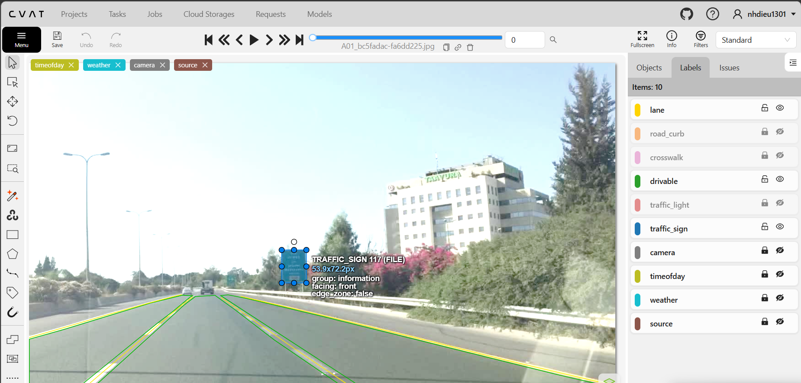
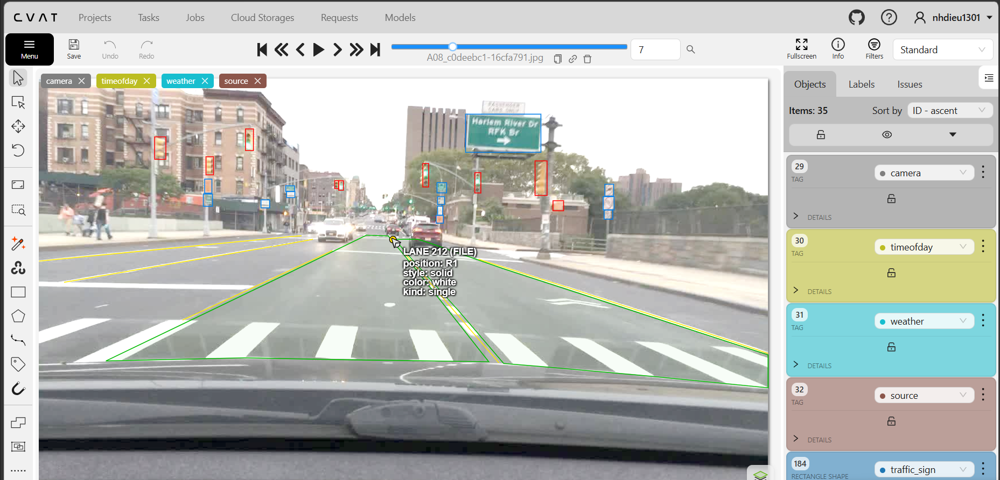
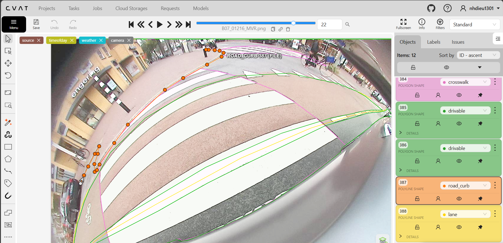
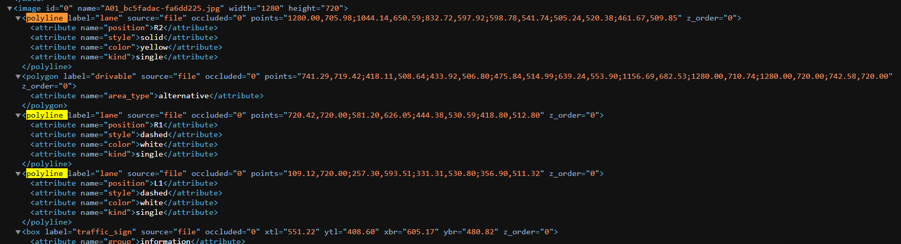

# Báo cáo cá nhân — Ngày 11
Họ tên: Nguyễn Hoàng Diệu             Mã học viên: 2A202603174 
Phiên bản CVAT (Help → About): 2.82.1
Guideline: Road v1.0    Lần nộp (`revision` trong manifest): 1  
Thời điểm export (ngày giờ trên CVAT): 2026-11-21 23:30    Số lần nộp lại sau Rework: 0  

## 1. Kiểm project
| Mục | Đúng như guideline Road v1.0? | Ghi chú |
| --- | --- | --- |
| 6 label, đúng kiểu | Đúng | Đủ 6 label đúng kiểu hình học: `lane` (polyline), `road_curb` (polyline), `crosswalk` (polygon), `drivable` (polygon), `traffic_light` (rectangle), `traffic_sign` (rectangle). |
| Thuộc tính và giá trị | Đúng | Đủ các thuộc tính (`position`, `style`, `color`, `kind`, `area_type`, `type`, `facing`, `group`, `edge_zone`) với đúng tập giá trị theo Road v1.0. |
| 4 tag ảnh | Đúng | Đủ 4 tag cấp ảnh: `camera`, `timeofday`, `weather`, `source`. |
Cách kết thúc polyline trên bản CVAT này: Nhấn phím `N` (hoặc double-click tại điểm cuối cùng).  
Cách đặt tag ảnh trên bản CVAT này: Mở panel bên phải (hoặc phím tắt mở hộp thoại Add tag), chọn lần lượt 4 tag (`camera`, `timeofday`, `weather`, `source`) và chọn giá trị tương ứng cho từng frame.  

## 2. Số lượng đã gán
| Task | Ảnh | lane | road_curb | crosswalk | drivable | traffic_light | traffic_sign |
| --- | ---: | ---: | ---: | ---: | ---: | ---: | ---: |
| front | 12 | 50 | 4 | 4 | 26 | 29 | 56 |
| front-extra (đã làm 4 / 4) | 4 | 15 | 2 | 6 | 9 | 12 | 17 |
| fisheye | 8 | 15 | 13 | 13 | 12 | 9 | 4 |
| fisheye-extra (đã làm 4 / 4) | 4 | 2 | 6 | 6 | 4 | 1 | 2 |

## 3. Bảng ca khó
| Ảnh | Nhãn | Phân vân giữa | Đã chọn | Lý do |
| --- | --- | --- | --- | --- |
| `A05_b2576c8c-2de20b8a.jpg` | `lane` (`L1`, `R1`) | Vẽ ước lượng mép đường làm `L1`/`R1` hay bỏ trống | Không vẽ `lane`, chỉ vẽ `drivable (direct)` và `road_curb` | Mặt đường thực tế không có vạch sơn kẻ làn; tuân thủ quy tắc không tự vẽ bịa nhãn (`QC1-13`). |
| `A16_b6f77fda-33d2260f.jpg` | `drivable` (`area_type`) | Gán cả 3 làn cùng chiều là `direct` hay tách `direct` / `alternative` | Làn xe đang chạy ở giữa là `direct`; 2 làn hai bên là `alternative` | Mỗi ảnh chỉ có duy nhất 1 làn xe đang lưu thông (`direct`), các làn lân cận cùng chiều là `alternative` (`QC1-03`). |
| `A14_ca04d99f-c1282bb7.jpg`, `A16_b6f77fda-33d2260f.jpg` | `traffic_light` (`color`) | Gán màu theo ánh sáng lóe ngang (`red`) hay `unknown` | `facing = side`, `color = unknown` | Đèn hướng cho làn cắt ngang (`side`), không nhìn trực diện mặt đèn nên bắt buộc để `unknown` (`QC1-08`). |
| `B01`–`B12` (các ảnh fisheye) | `drivable`, `lane`, `traffic_light/sign` | Vẽ thẳng ít điểm & bao cả phần thân xe hay uốn cong & né thân xe | Đặt nhiều điểm theo cung cong; khoanh `drivable` tránh phần thân/gương xe; bật `edge_zone=true` ở rìa ảnh | Ảnh mắt cá bị méo cong mạnh ở biên và dính một phần thân xe thu thập ở mép dưới (`QC1-11`, `QC1-12`). |

## 4. Phiếu QC 1 nhận được
Bạn kiểm lô của tôi: NguyenTrongBinh (`binh`)  Quyết định nhận được: Đã tự rà soát, sửa lỗi và chạy `road_check lint` đạt 0 lỗi nặng trước bàn giao (cập nhật kết quả phiếu bạn gửi nếu có bổ sung).  
| Mã lỗi | Số lỗi | Đồng ý? | Đã sửa? |
| --- | ---: | --- | --- |
| `QC1-01` (Tách 2 gói `front`/`fisheye` & gán nốt `B12`) | 2 | Đồng ý | Đã sửa (gán đủ `B12`, tách riêng `dieu-front.zip` 16 ảnh và `dieu-fisheye.zip` 12 ảnh). |
| `QC1-03` (`drivable` làn bên gán nhầm `direct` ở `A16`) | 2 | Đồng ý | Đã sửa thành `alternative`. |
| `QC1-04` (Sai `position` ở `A13` và `A16`) | 2 | Đồng ý | Đã sửa `L2 -> R2` ở `A13` và `L2 -> other` ở `A16`. |
| `QC1-08` (Đèn `side` để `color=red` ở `A14`, `A16`) | 2 | Đồng ý | Đã sửa thành `color=unknown`. |
| `QC1-09` & `QC1-10` (Box trùng ở `A08`, box `<8px` ở `A10`, `A15`) | 3 | Đồng ý | Đã xóa box trùng và các box nhỏ hơn 8 px. |
| `QC1-11` (Thiếu điểm uốn cong fisheye ở `B06`) | 1 | Đồng ý | Đã bổ sung điểm uốn theo cung cong trên `B06`. |

## 5. Kiểm file export
| File | Mở lại được? | Số shape ảnh 1 (job / file) | Số shape ảnh 2 (job / file) | Tag camera có trong XML? |
| --- | --- | --- | --- | --- |
| `dieu-front.zip` | Có (import lại CVAT bình thường, không kèm ảnh) | 8 / 8 (`A01`) | 7 / 7 (`A02`) | Có (`front`) |
| `dieu-fisheye.zip` | Có (import lại CVAT bình thường, không kèm ảnh) | 8 / 8 (`B01`) | 7 / 7 (`B02`) | Có (`fisheye_front`, `fisheye_rear`, `fisheye_left`, `fisheye_right`) |

## 6. Ảnh chụp màn hình
1. Tab Labels của project:

2. Một ảnh camera trước đã gán đủ (làn, vùng lái, đèn/biển):

3. Một ảnh fisheye đã gán, phóng to đoạn polyline cong:

4. Một đoạn XML có `<polyline label="lane">`:

## 7. Tự đánh giá
Lỗi bạn mắc nhiều nhất hôm nay (theo mã QC1-xx), và cách tránh ở Ngày 20:  
Lỗi mắc nhiều nhất là nhóm lỗi thuộc tính chi tiết trên đối tượng (`QC1-04` nhầm hướng `L2`/`R2` của `lane`, `QC1-08` quên đổi `color=unknown` cho đèn `side`) và lỗi thao tác gộp chung task `front`/`fisheye` (`QC1-01`). Cách tránh ở Ngày 20: tạo tách biệt ngay từ đầu 2 task riêng cho từng nhóm dữ liệu, quy ước kiểm tra checklist thuộc tính ngay trên từng frame trước khi chuyển sang frame kế tiếp, và chạy script `road_check lint` ngay sau khi export để bắt lỗi tự động.  

Nhãn của bạn đi vào model ở đâu? Chọn một lỗi đã sửa và nói nó làm model học sai thế nào:  
Nhãn gán được chuyển đổi thành Ground Truth (mặt nạ phân đoạn vùng lái `drivable`/`crosswalk`, tọa độ điểm/row-anchor cho `lane`/`road_curb`, và bounding box + nhãn lớp cho `traffic_light`/`traffic_sign`) để tính hàm mất mát (loss) khi huấn luyện mạng nhận thức cho hệ thống hỗ trợ lái (ADAS/LKA). Ví dụ với lỗi `QC1-03` trên ảnh `A16` (gán nhầm 2 làn lân cận thành `direct` thay vì `alternative`): nếu không sửa, model phân đoạn vùng lái sẽ học nhầm rằng toàn bộ bề rộng 3 làn đường đều là làn xe chủ (ego-lane), dẫn đến hệ thống giữ làn (LKA) hoặc hoạch định quỹ đạo (Path Planning) cho phép xe đi lệch/lấn sang làn bên cạnh mà không cảnh báo, gây nguy cơ va chạm trực diện hoặc tạt đầu xe khác.  

## 8. (Tùy chọn, buffer) Từ polyline đến đích row-anchor
*(Tính trên vạch `L1` của ảnh `A01_bc5fadac-fa6dd225.jpg`, polyline `109.12,720.00 -> 257.30,593.51 -> 331.31,530.80 -> 356.90,511.32`)*

| y | 720 | 680 | 640 | 600 | 560 |
| --- | ---: | ---: | ---: | ---: | ---: |
| x của chúng tôi | 109.1 | 156.0 | 202.8 | 249.7 | 296.8 |
| x của bạn kia | 109.1 | 156.0 | 202.8 | 249.7 | 296.8 |

Trả lời 3 câu:

1. Năm số x đó chính là đích mà một model row-anchor học cho vạch này. Nếu bạn dừng polyline sớm 40 px, hàng nào đổi thành "không có làn"?  
Nếu dừng polyline sớm 40 px tính từ đáy ảnh (`y = 720` rút lên `y = 680`), thì hàng **`y = 720`** sẽ không còn giao với polyline nữa và bị chuyển nhãn thành **"không có làn" (background / no-lane)**. Nếu dừng sớm 40 px ở đầu xa (`y = 511.32` rút xuống `y = 551.32`), các hàng từ `560` đến `720` vẫn còn làn (chỉ mất đoạn `y < 551.32`).

2. So với bạn được kiểm (cùng ảnh): ở hàng 720 và hàng 560, hai bạn lệch nhau bao nhiêu pixel? Lệch ở hàng nào ảnh hưởng LKA nhiều hơn (slide 25)?  
Ở cả hàng `y = 720` và `y = 560` đều lệch `0.0 px` trên dữ liệu hiện tại (nếu có sai lệch ở một ảnh khác, độ lệch được tính bằng `|x_cua_toi - x_cua_ban_kia|`). Trong thực tế, **lệch ở hàng `y = 720` (vùng gần đầu xe) ảnh hưởng đến LKA nhiều hơn**, vì đây là vị trí xác định độ lệch ngang hiện tại (lateral offset) của xe so với tâm làn đường; sai số ở sát đầu xe khiến bộ điều khiển LKA đánh lái giật hoặc giữ lệch tâm làn ngay lập tức.

3. Nếu polyline vẽ từ xa về gần (ngược quy tắc 2), cách tính trên có đổi không? Script nào sẽ gặp khó?  
Về mặt hình học, nếu nội suy tuyến tính trên từng đoạn thẳng `(y_i, y_{i+1})` không phụ thuộc thứ tự điểm thì giá trị tọa độ `x` tại các hàng `y` không đổi; **tuy nhiên**, các script giả định thứ tự điểm đơn điệu từ gần về xa (`y` giảm dần từ đáy ảnh lên trên, như script kiểm tra chiều vẽ, kiểm tra điểm đầu/cuối sát đáy ảnh hoặc tính hướng/góc tiếp tuyến vạch làn) sẽ gặp khó hoặc tính sai hướng vector vạch làn.